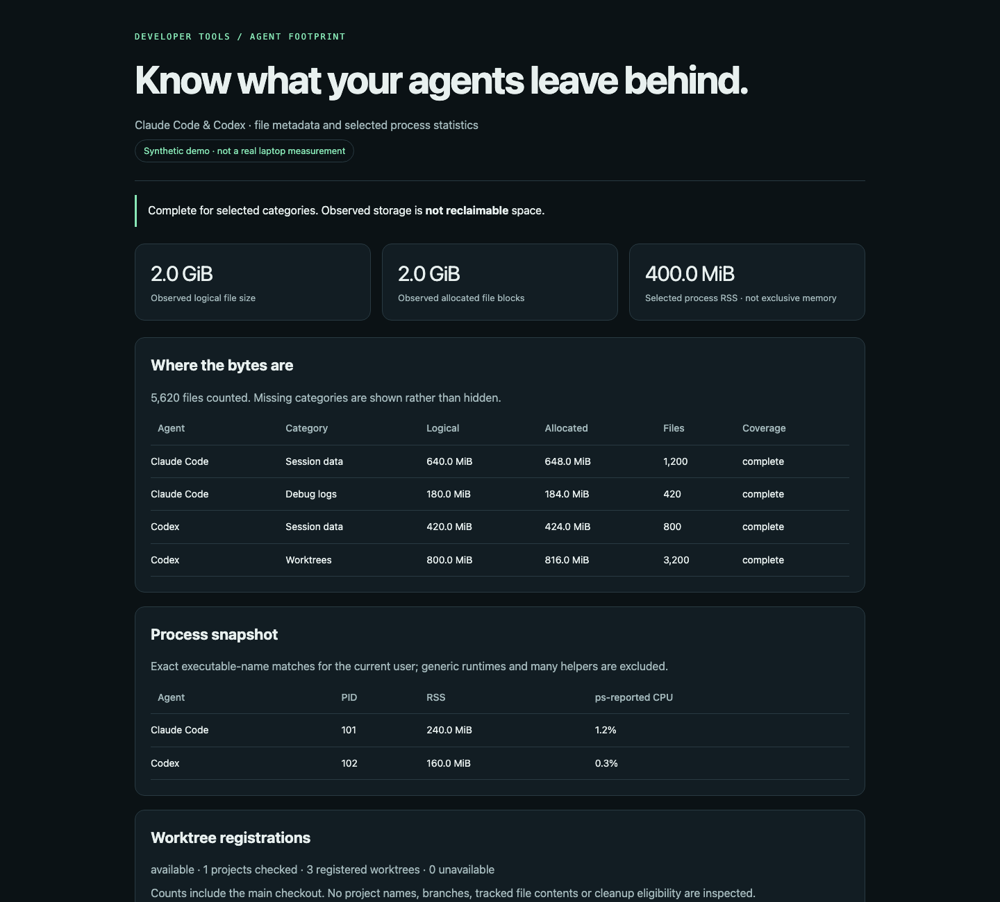

# Agent Footprint

**What are your AI coding agents leaving behind?**

See the local disk and selected process footprint of **Claude Code and OpenAI Codex** in one read-only report. No API key, no runtime dependencies, no telemetry, no cleanup commands.

[](https://github.com/gauravsinghbitmesra-design/agent-footprint/actions/workflows/ci.yml)
[](LICENSE)



**This is a footprint observer, not an optimizer or a memory-leak detector.** It shows evidence you can discuss with Claude or Codex before deciding what to do. It never declares sessions, worktrees or processes safe to remove.

[View the synthetic demo](https://gauravsinghbitmesra-design.github.io/agent-footprint/) · [Quick start](#try-it-in-a-minute) · [Report a bug](https://github.com/gauravsinghbitmesra-design/agent-footprint/issues/new/choose)

## Try it in a minute

Requires Python **3.10+**. Git is needed only to clone, or for optional worktree registration counts.

```sh
git clone https://github.com/gauravsinghbitmesra-design/agent-footprint.git
cd agent-footprint
python3 run.py --demo
python3 run.py
```

Windows PowerShell: use `py -3` instead of `python3`. The demo is entirely synthetic and does not inspect agent data or processes. The next command observes supported local agent directories and selected processes.

For a standalone HTML report, choose a **new filename**:

```sh
python3 run.py --format html --output footprint.local.html
```

Open that file in your browser. No web server, external fonts, JavaScript, or network connection is needed to view it. Existing output files are refused. The sample image above is generated from the [synthetic demo HTML](examples/demo.html).

## What you get

- **Disk breakdown:** session data, logs, file history, plugins, skills and Codex-managed worktrees, where those supported directories exist.
- **Two storage measurements:** logical file bytes and allocated file blocks. Hardlinks count once across categories; symlinks and special files are excluded.
- **Selected process snapshot:** current-user executables named exactly `claude`, `codex`, `Claude` or `Codex`. Includes RSS and `ps`-reported CPU; generic runtimes and most helper processes are excluded.
- **Honest coverage:** missing, skipped and partially inspected categories stay visible. A time or entry limit produces a partial report, not a fake complete total.
- **Shareable formats:** readable terminal summary, versioned JSON, and standalone HTML with next steps and limitations. No personal paths, project names, branch names or process arguments are emitted.

File **metadata only**: the collector does not open prompt, transcript, credential, environment or project file contents. It does read directory entries and file sizes. Optional Git checks read registration metadata. Reports retain aggregate counts, a UTC timestamp and selected process IDs/statistics: review before sharing; this is not a guarantee of anonymity.

## Commands

```sh
# Machine-readable report
python3 run.py --format json

# Explicit data roots; defaults are ~/.claude and ~/.codex
python3 run.py --claude-home /path/to/claude-data --codex-home /path/to/codex-data

# Reduce traversal budget or skip process observation
python3 run.py --max-files 20000 --timeout 3 --no-processes

# Opt-in: count registered worktrees for a trusted repository
python3 run.py --project /path/to/repo

# Synthetic, deterministic report; no local observation
python3 run.py --demo --format html --output demo.local.html
```

`--max-files` actually limits **visited entries, including directories**, across the whole disk scan. `--timeout` bounds disk traversal checks; process observation has a separate 3-second subprocess timeout, and optional Git queries share a 5-second budget. Slow filesystem calls can overrun traversal deadlines; this is not a hard wall-clock sandbox. Worktree checks accept at most 20 projects and count at most 100 distinct registrations, including main checkouts. No `git status`, fetch or tracked-file inspection is performed. Set explicit roots if your agent configuration uses custom locations; environment overrides are not automatically read.

A partial or unavailable observation still exits 0 because the report was produced; inspect its coverage fields. Invalid arguments/output errors exit 2; interruption exits 130.

## Optional installation

Run directly from a clone with no installation, or install the console command in an isolated environment:

```sh
python3 -m venv .venv
.venv/bin/python -m pip install .
.venv/bin/agent-footprint --demo
```

Windows:

```powershell
py -3 -m venv .venv
.\.venv\Scripts\python.exe -m pip install .
.\.venv\Scripts\agent-footprint.exe --demo
```

There is no PyPI release assumed here. Install this checkout, not an unrelated similarly named package.

## Use with Claude or ChatGPT/Codex

Open this clone in a local coding agent and say:

> Read AGENTS.md and PROMPT.md. Run Agent Footprint read-only, explain coverage and the largest observed categories, and tell me what further evidence would be needed before cleanup. Do not delete files, stop processes, or alter agent settings.

See [PROMPT.md](PROMPT.md), [AGENTS.md](AGENTS.md) and [CLAUDE.md](CLAUDE.md). Plain web chats cannot inspect your laptop: run the command yourself and share the reviewed report. No model subscription or model API is required to run the utility.

## Compatibility and limits

| Platform | Disk metadata | Process snapshot | Optional Git counts |
|---|---|---|---|
| macOS | Yes; POSIX no-follow directory descriptors | Exact-name `ps` matches | Yes |
| Linux | Yes; POSIX no-follow where supported | Exact-name `ps` matches | Yes |
| Windows | Yes; best-effort reparse/symlink exclusions | Unavailable in v0.1 | Yes |

Fixture tests run in CI on all three platforms. A real macOS smoke test is documented separately; CI does not prove every agent release or filesystem works. Windows cannot provide the same descriptor-based race protection: avoid scanning data while another process is moving directories. No administrator access is required.

**Storage is not savings.** Disabled agents or old sessions can contain important work. Allocated block sums are not unique physical disk consumption on cloned/compressed filesystems. RSS can double-count shared memory; the selected process set is incomplete, and names are heuristic. This report does not establish that agents caused a slowdown. See [measurement notes](docs/measurements.md), [privacy](docs/privacy.md) and [validation](docs/validation.md).

## Why another tool?

This project focuses on a small, inspectable, dependency-free **observation step** that works before a cleanup decision. [cc-reaper](https://github.com/theQuert/cc-reaper) and [agentdust](https://github.com/hamzahamidi/agentdust) address related cleanup problems; [ccusage](https://github.com/ccusage/ccusage) addresses model usage. They are independent projects, not dependencies or endorsements. No competitor code is bundled here.

## Help shape it

Try the command, then [open an issue](https://github.com/gauravsinghbitmesra-design/agent-footprint/issues/new/choose) with your platform, Python version and a **reviewed aggregate report**. Never upload raw agent logs, transcripts, credentials or command arguments.

Useful contributions: new data-directory adapters with tests, better platform coverage and clearer attribution evidence. We prefer honest missing data over a confident guess. See [CONTRIBUTING.md](CONTRIBUTING.md) and [SECURITY.md](SECURITY.md).

If this helped you understand your laptop, a star helps others find it. Forks and small, tested improvements are welcome. [MIT licensed](LICENSE).
